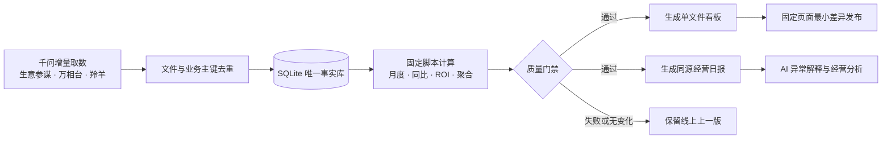

# Tmall Ops Workflow

## 每天只补昨天，剩下的交给数据生产线

一套把 **AI 取数、SQLite 事实库、确定性计算、质量门禁、固定看板发布和经营日报**串起来的电商数据自动化工作流。

它不是又一个看板，也不是让 AI 每天重新写一遍报表。它解决的是更底层的问题：**数据只取一次、事实只存一份、指标只算一处、页面固定更新、异常有据可查。**

> 公开仓库包含通用工作流引擎、配置示例、数据契约和测试；不包含任何真实店铺经营数据、账号凭证、个人目录或线上页面节点。

---

## 为什么值得做

很多电商团队已经能拿到数据，却依然每天被这些事情消耗：

| 日常痛点 | 这套工作流的做法 |
|---|---|
| 每天重复抓整段历史，慢且贵 | 稳定历史只迁移一次，日常只补昨天 |
| 同一日期重复入库，汇总越做越大 | 文件哈希 + 业务主键幂等写入 |
| 店铺、商品、流量、广告口径互相混用 | 分域保存，来源、终端和归因口径显式隔离 |
| 万相台归因成交后验变化，被当成新增数据 | 同一主键覆盖，并保留每次修订历史 |
| AI 每天重新读字段、重算指标，偶尔认错 | 月度、同比、ROI、占比和聚合全部由固定代码完成 |
| 看板和日报各有一套数字 | 两者读取同一个数据库导出结果 |
| 更新网页要重新上传，链接越攒越多 | 原固定页面做最小差异更新，无变化跳过 |
| 数据错了，线上也被覆盖 | 质量门禁失败即停止，线上保留上一版 |

---

## 30 秒看懂整条流程



- [Archify 流程图源文件](docs/workflow.archify.json)
- [数据契约](docs/DATA_CONTRACT.md)
- [运行与故障处理](docs/OPERATIONS.md)
- [千问每日任务书](docs/QWEN_DAILY_TASK.md)

---

## 最核心的六个能力

### 1. 增量，而不是反复重建

首次迁移历史基线后，店铺、类目、SKU、商品和流量原则上只取 N-1。只有源端修订或明确缺数才回补指定日期。

### 2. 幂等，而不是越跑越多

相同文件直接跳过；相同业务主键只更新原记录。重复执行不会制造重复事实，也不会把消耗和成交累加两次。

### 3. 口径隔离，而不是能拼就拼

店铺 UV 不等于商品访客，流量渠道不等于广告归因，TOP 榜不等于全量。不同终端、来源和归属原则各自保留边界。

### 4. 确定性计算，而不是每天靠 AI 猜

月度、去年同期相同天数、支付转化率、ROI、类目占比、近 7 天商品聚合，全部由可测试的 Python 代码生成。

### 5. 发布门禁，而不是先上线再检查

数据新鲜度、序列完整性、窗口截止日、类目与商品成交总额全部通过后，才允许生成和发布页面。

### 6. AI 回到高价值分析

AI 不再承担机械搬运和重复计算，转而做异常解释、经营洞察、竞品对比和动作建议。

---

## 谁适合用

- **电商运营 / 品牌经营团队**：每天需要稳定、同口径的经营看板和日报。
- **数据分析师**：希望把时间花在分析，而不是清洗重复文件。
- **AI 工作流搭建者**：需要一套可复用的“Agent 取数 + 本地事实库 + 固定发布”范式。
- **中小业务团队**：不想一开始就建设重型数据平台，又需要基本的数据治理。

### 推荐切入点

不要从“把所有平台全部接入”开始。最划算的第一步是：

1. 先接 **一个店铺、一个日期、一条店铺日事实**；
2. 跑通重复执行不重复入库；
3. 再接万相台归因回补；
4. 最后扩展 SKU、流量、窗口明细和自动发布。

先证明“每天少做一次机械工作”，再扩大数据域。

---

## 工具介绍

| 工具 | 在流程里的角色 |
|---|---|
| 千问 + 生意参谋 / 万相台 / 羚羊 MCP | 按任务书获取增量数据，不负责页面 |
| Python 3 | 数据校验、幂等入库、聚合、日报和发布编排；核心仅使用标准库 |
| SQLite | 本地唯一事实库，保存日事实、业务主键、来源文件和归因修订 |
| HTML + ECharts | 固定展示模板，由数据库生成数据块后打包 |
| WorkBuddy Library Page | 既有固定页面的最小差异更新、发布和回读验证 |
| GitHub Actions | 推送后自动运行核心单元测试 |
| Archify | 工作流交互架构图的源文件与渲染工具 |

---

## 快速开始

### 环境要求

- Python 3.10+
- 已有数据文件与看板模板
- 如需自动发布：WorkBuddy 及一个**已经存在**的 Library Page 节点

### 1. 准备本地配置

```bash
cp pipeline_config.example.json pipeline_config.json
```

把示例中的路径替换成本机路径。`pipeline_config.json` 已被 `.gitignore` 排除，不会随代码上传。

### 2. 运行测试

```bash
PYTHONPATH=src python3 -m unittest discover -s tests -v
```

### 3. 只执行增量入库

```bash
python3 src/daily_pipeline.py ingest --config pipeline_config.json
python3 src/daily_pipeline.py status --config pipeline_config.json
```

### 4. 校验并生成看板

首次生成前，需要准备历史基线、近 7 天一级类目和 SKU 数据，以及本地看板模板。模板要求见 [数据契约](docs/DATA_CONTRACT.md)。

```bash
python3 src/daily_pipeline.py run --config pipeline_config.json
```

### 5. 可选：更新既有固定页面

```bash
export WORKBUDDY_LIBRARY_SKILL_DIR="/path/to/workbuddy/skills/library"
python3 src/daily_pipeline.py run --config pipeline_config.json --publish
```

发布只替换 `window.__DASH__` 和 `window.__LY__` 两段数据，保留线上 app、平台注入和页面功能。**不会自动创建新页面。**

---

## 项目结构

```text
src/
  daily_pipeline.py       # 增量入库、事实库、计算、质量门禁
  html_builder.py         # 单文件看板打包
  publish_dashboard.py    # 固定页面最小差异发布与回读
  make_report.py          # 同源经营日报
tests/
  test_daily_pipeline.py  # 幂等、归因回补、同比、商品主数据测试
docs/
  DATA_CONTRACT.md        # 输入文件、字段和页面模板契约
  OPERATIONS.md           # 每日运行、排障与发布保护
  QWEN_DAILY_TASK.md      # 可直接交给取数 Agent 的任务书
  workflow.archify.json   # Archify 数据流图源文件
pipeline_config.example.json
.github/workflows/test.yml
```

---

## 数据诚信红线

- 缺失不填 0。
- 不把窗口汇总均摊成日事实。
- 不把 TOP30/60 当全量商品。
- 不跨终端、来源或归属原则拼接同一条事实。
- 万相台回补只覆盖同一业务主键，不累加。
- 未通过校验的数据不发布。
- 真实数据、数据库、凭证和本地配置不进入 Git。

---

## 边界与 roadmap

这套仓库是**可复用的数据工作流引擎**，不是生意参谋或万相台的采集器，也不包含任何店铺私有 HTML 模板。取数权限和 MCP 能力由使用方自己的账号环境提供。

后续可扩展方向：

- 商品和流量完整日事实到任意窗口的本地聚合
- 更多平台的数据源适配器
- 数据质量告警与企业微信 / 飞书通知
- 可复用的通用看板模板
- 更多运营动作与复盘数据结构

---

## 一句话带走

**让 AI 负责获取和解释，让数据库负责记住，让脚本负责算对，让固定页面负责稳定呈现。**
