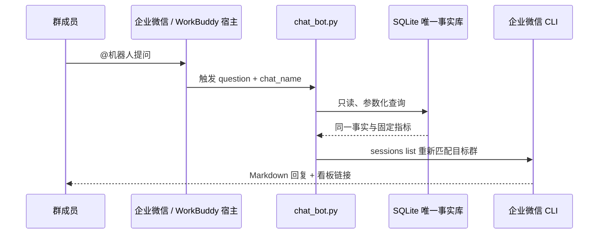

# 群聊问数机器人：让群里直接问同一数据底座

运营不再需要先打开看板、找到对应页面、再截图解释。群里可以直接问：

> @数据助手 昨天销售怎么样？  
> @数据助手 万相台近 7 天 ROI 多少？  
> @数据助手 数据更新到哪一天？  
> @数据助手 看板链接

机器人读取与看板、日报完全相同的 SQLite 事实库，用固定指标公式生成答案，再通过企业微信 CLI 回复 Markdown。

## 30 秒看懂链路



**必须理解的边界：** 企业微信 CLI 当前提供会话列表和发送消息能力，不提供群消息监听/读取能力。因此，本仓库实现的是“问数与回复引擎”；“群内新消息到达后立即调用本程序”由企业微信或 WorkBuddy 宿主完成。没有宿主触发时，仍可手工执行或由定时任务调用，但不能把它描述成 CLI 自己已经在群里实时监听。

## 已支持的固定问题

| 问法示例 | 数据来源 | 回答内容 |
|---|---|---|
| 昨天销售怎么样？ | `store_daily_facts` | GMV、买家、UV、转化率、客单价、可得时同比 |
| 近 7 天经营怎么样？ | `store_daily_facts` | 区间汇总、日均 GMV、转化率、覆盖提示 |
| 2026-01-02 销售怎么样？ | `store_daily_facts` | 指定日事实 |
| 万相台近 7 天 ROI | `wxt_daily_facts` | 消耗、归因成交、ROI、订单、加购、动态归因说明 |
| 近 7 天一级类目 TOP5 | `category_daily_facts` | 仅对 7 天日期和成交均完整的一级类目排名，不跨层级重复汇总 |
| 数据更新到哪一天？ | 店铺与万相台事实表 | 两个数据域各自最新日期 |
| 看板链接 | 本地 `dashboard_url` | 固定看板入口 |

不支持的自由问题会返回帮助，不会让模型编一个数字。缺失日期和指标明确提示，不填 0。

## 配置

在本地 `pipeline_config.json` 增加：

```json
{
  "dashboard_url": "https://your-fixed-dashboard-url",
  "wecom_cli": "wecom-cli",
  "chat_allowed_groups": ["你的经营分析群"]
}
```

- `dashboard_url` 不进入 Git；示例链接不会被当作真实看板发送。
- `chat_allowed_groups` 是发送白名单，空清单或群名不匹配都会拒绝发送。
- 数据库路径沿用现有 `database` 配置。
- 不配置或保存群内部标识；每次发送都从当次会话列表重新匹配。

## 先预览，不发送

```bash
python3 src/chat_bot.py ask \
  --config pipeline_config.json \
  --question "昨天销售怎么样？"
```

默认只打印答案，不调用企业微信 CLI。

## 发送到企业微信群

前置条件：

1. 已安装企业微信 CLI 1.2.1 或更高版本，并已完成授权。
2. 机器人与目标群最近有消息往来，目标群会出现在当次可发送会话列表里。
3. 群名已加入 `chat_allowed_groups`。

```bash
python3 src/chat_bot.py ask \
  --config pipeline_config.json \
  --question "万相台近7天ROI怎么样" \
  --chat-name "你的经营分析群" \
  --send
```

发送前会依次检查 CLI 版本、授权状态、当次群会话和发送白名单。只有显式传入 `--send` 才发消息。

## 接入实时群消息宿主

宿主收到群消息后，只需把两个值交给本模块：

```text
question  = 去掉机器人称呼后的用户问题
chat_name = 当前群的可读名称
```

然后执行与上面相同的 `ask --send` 命令。建议宿主增加以下生产保护：

- 只响应 @机器人 或指定前缀，避免每个群消息都触发。
- 对同一群做短时限流，避免重复提问造成消息刷屏。
- 保留问题、回答日期和发送结果，但不公开群内部标识。
- 发送失败不影响每日入库和看板发布。

## 飞书 CLI 如何复用

查询与指标层不依赖企业微信：`answer_question()` 只接收 SQLite 连接、问题和配置。使用飞书的团队可以复用同一答案引擎，再按自己实际安装并已验证的飞书 CLI 增加发送器与群消息宿主触发。

当前公开版本选择完整实现企业微信 CLI 发送器，**没有伪造未核实的飞书命令，也没有宣称飞书群监听已经接通**。

## 安全与数据诚信

- SQLite 使用 `mode=ro` 和 `query_only`，问数过程不能改库。
- 只提供固定问题解析和参数化查询，不开放自由 SQL。
- 机器人回答与看板、日报同源，不另造一套指标。
- 缺失不填 0；部分区间覆盖会显示实际覆盖天数。
- 万相台回答保留动态归因口径说明，不把后验回补当成新增成交。
- 发送白名单、群名精确匹配和当次会话校验缺一不可。
